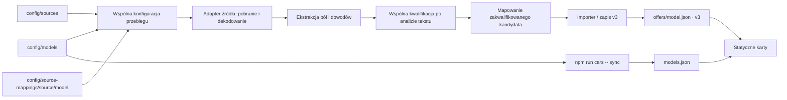

# Architektura

Projekt ma dwa niezależne wejścia: lokalne narzędzie do odczytu portali i statyczną stronę. Strona nie uruchamia wyszukiwania ani nie zapisuje własnych ocen czy decyzji. Poniższy diagram opisuje docelowy przepływ danych po wdrożeniu ekstrakcji pól i mapowania.

## Granice odpowiedzialności

### Konfiguracja

Profil `config/models/<key>.json` jest jedynym miejscem kryteriów konkretnego modelu. Zawiera wymagane wartości ceny, rocznika, przebiegu i wariantów silnika oraz podział wyświetlanych pól. Wspólne wartości dla portalu nie trafiają do tego pliku.

`config/sources/<source>.json` przechowuje nazwę portalu, adapter, URL wyszukiwania, limity i ustawienia charakterystyczne dla adaptera. `config/source-mappings/<source>/<model>.json` zawiera portalowe nazwy modelu i wyjątki URL. Loader przekazuje je do adaptera jako `adapterOptions.modelMappings`; wspólna warstwa nie tłumaczy pól konkretnego portalu. Wpis `supported: false` wyłącza model dla portalu do czasu ręcznego sprawdzenia mapowania.

`models.json` jest wygenerowanym indeksem v2 dla GitHub Pages. Nie jest źródłem kryteriów ani mapowań. Walidacja sprawdza zgodność indeksu z aktywnymi profilami.

### Kod wyszukiwania

- `scripts/cars.mjs` jest jednym punktem wejścia CLI; `src/cli/` rozdziela walidację i synchronizację, modele, źródła oraz bezpośrednie wyszukiwanie.
- `src/config/load-search-config.mjs` łączy wspólny profil z konfiguracją źródła i mapowaniem.
- `src/search/direct/runner.mjs` orkiestruje przeglądarkę, filtry, listę wyników i odczyt kart. `criteria.mjs`, `listing-data.mjs` i `runner-helpers.mjs` wydzielają odpowiednio kryteria, dowody z kart i funkcje pomocnicze przebiegu.
- `src/search/direct/adapters/` zawiera niezależne adaptery portali; teraz skonfigurowane są OTOMOTO i AAA Auto. `src/search/direct/adapter-contract.mjs` sprawdza wymagane metody i normalizuje wspólny kształt kandydata listy oraz karty.
- `src/search/shared/` zawiera współdzielone przesiewanie i klasyfikację.
- `src/offers/` definiuje rekord, migrację i jedyną ścieżkę zapisu baz ofert.

Nowy portal implementuje kontrakt adaptera opisany w [source-adapter-contract.md](source-adapter-contract.md). `npm run cars -- source add ...` tworzy wyłączony plik źródła oraz puste, wyłączone mapowania dla modeli; aktywacja jest osobnym krokiem po sprawdzeniu URL-i. Adapter odczytuje ustawienia portalu z konfiguracji źródła, a wyjątki modelu z przekazanej mapy. Nowy model dostaje profil kryteriów i pól, kartę wiedzy, osobne mapowanie dla każdego portalu i pusty plik `offers/<key>.json` tworzony przez moduł ofert. Usunięcie modelu usuwa wszystkie jego dane konfiguracyjne i bazę ofert danego modelu.

Runner zapisuje wybrane dane adaptera w wyniku przebiegu pod `sourcePayload.<sourceId>`, osobno dla listy i karty. To tymczasowy ładunek źródłowy; importer mapuje z niego wybrane dodatkowe pola do trwałego `listings[].sourceExtensions.<sourceId>`.

Po normalizacji adaptera `candidate-field-extractor.mjs` zbiera wartości z pól adaptera, pól karty, JSON-LD, tytułu i tekstu całego ogłoszenia. Zapisuje `extraction.facts`, `extraction.fieldEvidence`, wykryte konflikty oraz `missingRequired` i `unresolvedRequired` razem z listą sprawdzonych miejsc. Dopasowanie wariantu silnika korzysta z aliasów konkretnego modelu. Kwalifikacja odbywa się po tej ekstrakcji: wymagane pola brakujące lub sprzeczne odrzucają kandydata, a zakres ceny, rocznika, przebiegu i wariant silnika są sprawdzane na potwierdzonych wartościach.

`src/offers/mapper.mjs` mapuje zakwalifikowanego kandydata na fakty wspólne i opcjonalne rozszerzenia źródła. `src/offers/import-run.mjs` zapisuje je przez `records.mjs`: `listings[].facts` zawiera pola wspólne, `listings[].sourceExtensions.<sourceId>` wybrane dodatkowe pola źródła, a `listings[].fieldEvidence` dowody z ekstrakcji. Importer pomija kandydatów z nierozwiązanymi wymaganymi polami i waliduje ponownie wymagane kryteria przed zapisem.

## Kryteria i wynik

Docelowo nowa oferta trafi do importu po potwierdzeniu wymaganych pól z profilu: ceny podanej w ogłoszeniu, rocznika, przebiegu i dokładnego wariantu silnika. Cena będzie porównywana z limitami niezależnie od tego, czy portal oznacza ją jako netto lub brutto; `priceBasis` pozostanie informacją pomocniczą. Silnik może być rozpoznany z danych strukturalnych, widocznej karty albo opisu przez aliasy z `knowledge/models/<key>.json`. Brak pola w JSON-ie listy nie kończy kwalifikacji: adapter i ekstraktory sprawdzą też szczegóły, tytuł, opis oraz wyposażenie. Niepotwierdzone albo sprzeczne wymagane wartości po pełnej ekstrakcji nie zakwalifikują kandydata.

Wspólny format v3 zapisuje fakty ujednolicone w `listings[].facts`. Nieprzenoszalne pola portalu trafiają opcjonalnie do `listings[].sourceExtensions.<sourceId>`, a `listings[].fieldEvidence` przechowuje źródło, ścieżkę i metodę odczytu znormalizowanej wartości. Te dodatki nie zastępują wspólnych pól i same nie blokują kwalifikacji. Mapper i importer zapisują je przez wspólny moduł rekordów.

VIN, pierwsza rejestracja, skrzynia i nadwozie nie blokują zapisu. Profil określa pola wymagane, półwymagane i opcjonalne; UI renderuje te grupy bezpośrednio z konfiguracji modelu. Braki pól półwymaganych są oznaczane. Pola opcjonalne pojawiają się tylko wtedy, gdy profil je włączy i odczytano wartość.

## Obecny zakres

Aktywne są bezpośrednie adaptery OTOMOTO i AAA Auto. Pozostałe źródła nie uczestniczą w wyszukiwaniu, dopóki nie otrzymają adaptera i potwierdzonych mapowań. Osobny proces cyklicznego sprawdzania aktywności ofert nie jest jeszcze podłączony.
